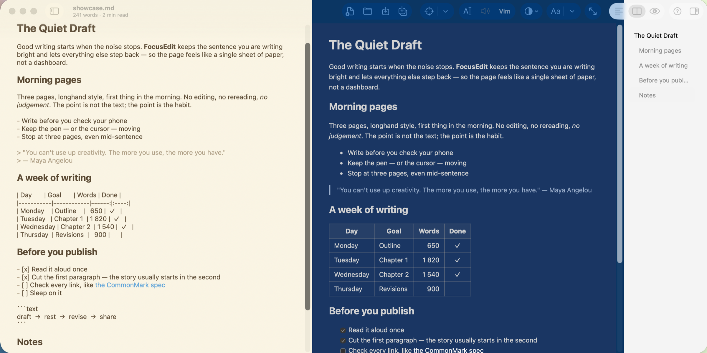
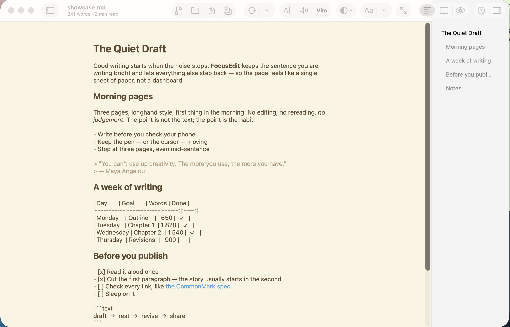
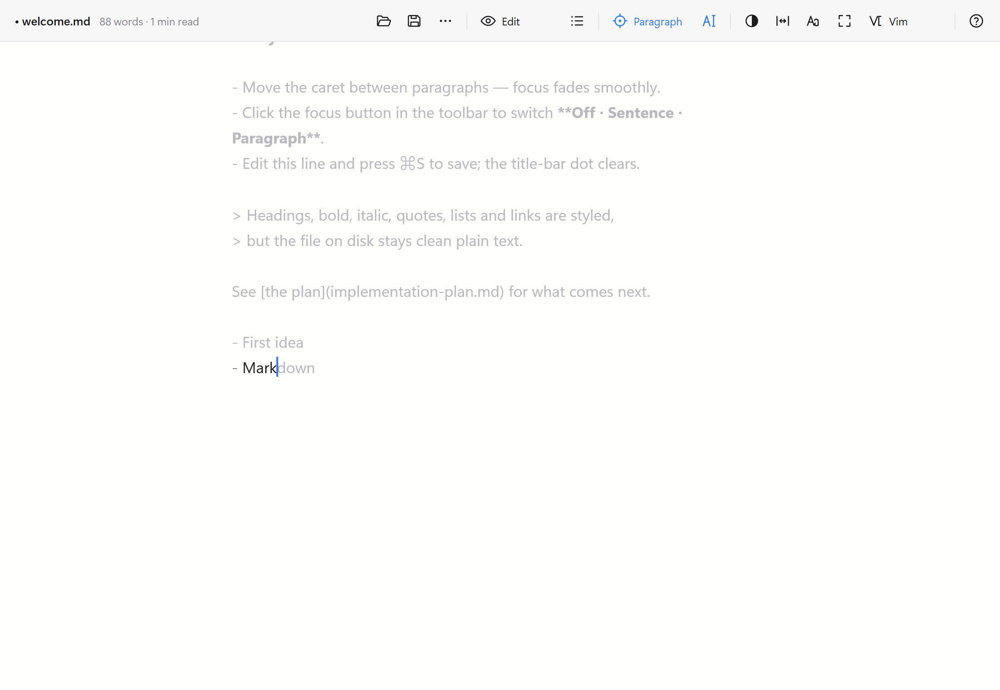
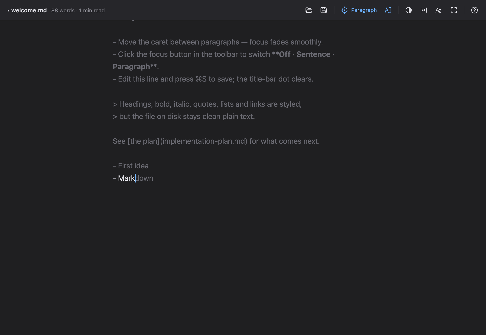

<p align="center">
  
</p>

<h1 align="center">FocusEdit</h1>

<p align="center">
  <b>A calm, minimalist editor for distraction-free writing.</b><br>
  It fades everything you are not working on — and saves plain text: Markdown, Fountain or ordinary <code>.txt</code>.
</p>

<p align="center">
  <a href="https://github.com/maximkurein/FocusEdit/releases/latest"></a>
  
  
  <a href="LICENSE"></a>
  <a href="https://github.com/maximkurein/FocusEdit/actions/workflows/windows.yml"></a>
</p>

<p align="center">
  <a href="https://github.com/maximkurein/FocusEdit/releases/latest"><b>Download</b></a> ·
  <a href="#highlights">Highlights</a> ·
  <a href="#shortcuts">Shortcuts</a> ·
  <a href="#build-and-run">Build</a> ·
  <a href="#windows-experimental">Windows</a> ·
  <a href="#support">☕ Support</a>
</p>

<p align="center">
  
</p>

**Version:** `1.6.11`, released 28.10.2026 · [changelog](CHANGELOG.md) · [how versions are managed](VERSION_MANAGEMENT.md)

## Highlights

<table>
  <tr>
    <td width="33%" valign="top"><b>🎯 Focus</b><br>Only the current sentence or paragraph stays bright; the rest steps back. Typewriter scrolling keeps your line in the middle.</td>
    <td width="33%" valign="top"><b>✍️ Plain text, styled</b><br>Live Markdown hides the marks away from the cursor. Fountain screenplays are highlighted too. The file stays clean text.</td>
    <td width="33%" valign="top"><b>👀 Edit · Split · Preview</b><br>A live preview beside the text with its own theme, scrolling together with it. Export to HTML or PDF.</td>
  </tr>
  <tr>
    <td valign="top"><b>💡 Writing aids</b><br>A quiet grey word suggestion, auto-closing pairs, list continuation, paste a URL over text to make a link.</td>
    <td valign="top"><b>⌨️ Learn Vim</b><br>A Vim mode with a coach that explains every command — in English and in the Russian layout.</td>
    <td valign="top"><b>🎨 Themes</b><br>System, Light, Dark, Sepia, PowerShell or your own. Zoom with ⌘+/⌘− or ⌘-scroll; the preview follows.</td>
  </tr>
</table>

<table>
  <tr>
    <td width="50%"></td>
    <td width="50%"></td>
  </tr>
  <tr>
    <td align="center"><sub>macOS · Sepia, editor and outline</sub></td>
    <td align="center"><sub>Windows · Light</sub></td>
  </tr>
</table>

## Download

| Platform | Get it | Notes |
|---|---|---|
| **macOS 13+** (Apple Silicon and Intel) | `FocusEdit-<version>.dmg` from [Releases](https://github.com/maximkurein/FocusEdit/releases/latest) | Open the DMG and drag FocusEdit into Applications. The build is not notarized: the first time, choose **System Settings → Privacy & Security → Open Anyway**. |
| **Windows 10/11** (experimental) | the `.exe` installer from [Releases](https://github.com/maximkurein/FocusEdit/releases/latest), or the latest **FocusEdit-windows** artifact in [Actions](https://github.com/maximkurein/FocusEdit/actions/workflows/windows.yml) | A separate app built with Tauri; see [Windows (experimental)](#windows-experimental). |

Or build it yourself: [Build and run](#build-and-run).

> **Status: prototype.** Everything listed below works. Not yet done: iCloud sync and version conflicts, a Quick Look extension, screenplay page layout for Fountain PDF export, and a signed, notarized build.

## Everything it does

<details>
<summary>The full feature list</summary>

- **Focus** — highlight only the current sentence or paragraph (the text up to the blank lines; a heading or a list item counts as its own block), with a short fade as you move; the typewriter button keeps the active line at the centre of the window and starts off, so a file opens at the top; optional typewriter sounds; full screen hides the toolbar and the menu bar.
- **Writing aids** — a grey suggestion completes the word you are typing from words already in the document, then from the system dictionary (English and Russian); brackets and quotes close themselves and wrap a selection; pasting a web address over selected text makes a Markdown link `[text](address)`; Return continues Markdown lists, task lists and quotes. In Fountain, scene headings and character names you have used are suggested.
- **Live Markdown** — the marks of formatting (`#`, `**`, `*`, `~~`, `` ` ``, `[ ](…)`, `<…>`) are hidden away from the cursor and appear as it comes close; headings get their size. Modus ▸ Live Markup or the palette (*Markup*) turns it off.
- **Plain text, styled on screen** — Markdown headings, emphasis, code, quotes, lists, links and CriticMarkup; Fountain scene headings, characters, parentheticals and transitions. Styling is display-only: the file on disk stays clean plain text.
- **Vim mode for learning** — Modus ▸ Vim Mode: Normal, Insert and Visual modes with the operator + motion grammar (`dw`, `ciw`, `3j`, `.`), and a coach bar under the text that explains every command and suggests faster ways. Leave it with the Exit Vim button on the coach bar or `:novim`. Works in the Russian keyboard layout too. A lesson-by-lesson course is in [VIM_GUIDE.md](VIM_GUIDE.md).
- **Files** — New File…, Open, Save and Save As… buttons in the toolbar; an empty untitled document shows a start screen (New File…, Open…, recent files); `⌘W` closes the file and leaves that start screen, as on Windows.
- **New File…** — `⇧⌘N` opens a three-step dialog: pick the format (`.txt`, `.md` or `.rtf`), what to start from (blank, note, to-do list, meeting notes), then the name and the folder; the file is created and opened. The same dialog is in the Windows version (`Ctrl+Shift+N`).
- **RTF** — `.rtf` files (TextEdit's default format) open as Markdown and save back as RTF: bold, italic, strikethrough, headings, lists, links and code survive the round trip; fonts, colours, images and tables do not, and FocusEdit warns when a file has them. **FocusEdit ▸ Make Default Editor for .txt and .rtf** makes double-clicked text and RTF files open in FocusEdit.
- **Documents** — standard macOS documents: open, save, revert, recent files, drag and drop, and autosave elsewhere every minute so unsaved text survives a crash; quitting with unsaved changes always asks whether to save them. A library sidebar (⌥⌘L) lists one folder you choose — its documents and subfolders, opened with a double-click; choose the folder with the sidebar's button, Library ▸ Link Directory… or by dropping it on the sidebar; the outline jumps between headings and keeps the one you are in selected; the window subtitle shows the word count and reading time, the words in the selection, or — with a word goal set from the palette — the words written this session, the time spent writing and a thin progress bar under the toolbar; find and replace.
- **Preview and export** — live HTML preview for Markdown in a pane beside the text (tables, task lists, strikethrough, nested lists, reference links), scrolling together with it, export as HTML or PDF, copy as HTML, print; print and PDF are dark on white in any theme, with nothing faded by focus.
- **Themes and type** — System (follows the macOS light or dark appearance as it changes), Light, Dark, Sepia, PowerShell (the PowerShell 7 console: navy and light gray) and custom themes. The preview follows the editor until View ▸ Theme ▸ Preview gives it its own theme; that choice is remembered. System, monospaced or serif font. In the editor alone the text sits in a reading column; beside the preview it uses the pane, and the divider sets the width.
- **Command palette** — `⇧⌘P`: type a few letters of what you want to do (a theme, a view, export, a recent file…) and press Return; a number sets a word goal or jumps to that line.
- **Help where you are** — every toolbar button has a tooltip with its shortcut, ⌘? opens a cheat sheet for the current document type, and the first start opens a welcome tour that teaches by being edited (Help ▸ Welcome Tour shows it again).

</details>

## Shortcuts

| Keys | Action |
|---|---|
| Tab or → | Accept the grey suggestion |
| Esc · ⌥Esc | Dismiss the suggestion · list all completions |
| ⇧⌘P | Command palette: every action by typing a few letters; a number sets a word goal or goes to that line |
| ⇧⌘N | New File…: format, template, name |
| ⌘T | Keep the active line centred |
| ⌘U | Typewriter sounds |
| ⌥⌘P | View: Edit → Split (live preview) → Preview only; Esc leaves Preview (Markdown) |
| ⌥⌘L · ⌥⌘O | Library · outline |
| ⌘B · ⌘I · ⌘K | Bold · italic · link |
| ⌃⌘F | Full screen |
| ⌘? | Hints and shortcuts |

## Requirements

- macOS 13 or later to run; Xcode 26 to build (tested with Xcode 26.5, Swift 6.3)
- No third-party dependencies: AppKit, WebKit and AVFoundation only
- Python 3 for `scripts/update_version.py` (standard library only)

## Build and run

```bash
./package.sh   # build Release and pack build/FocusEdit-<version>.dmg
./install.sh   # install that DMG into Applications and refresh the Dock icon
```

`package.sh` checks that the version files agree, builds a universal Release (Apple Silicon and Intel), assembles the app bundle, stamps a UTC build number, renders the app icon (it is drawn in code), ad-hoc signs and verifies the bundle, then packs and verifies the DMG. `./package.sh --no-dmg` builds only `build/FocusEdit.app` (Finder shows this folder; the compiler's own files stay in the hidden `.build`), which runs in place: `build/FocusEdit.app/Contents/MacOS/FocusEdit examples/welcome.md`. Always rebuild with `package.sh`: copying a new binary into an existing bundle invalidates its signature and macOS kills the app at launch.

`install.sh` quits a running FocusEdit, moves the installed copy to the Trash (nothing is deleted), copies the new one, re-registers it with Launch Services and restarts the Dock, which otherwise can keep a blank cached icon. To install by hand instead, `./package.sh --open` opens the DMG in Finder; drag **FocusEdit** into **Applications**.

The build is ad-hoc signed, not notarized: it opens without warnings on the Mac that built it, while on other Macs macOS blocks it until you choose **System Settings → Privacy & Security → Open Anyway**.

The step-by-step build guide with common problems: [BUILD.md](BUILD.md) (in Russian).

## Command line

```bash
FocusEdit [file]                          # open a document
FocusEdit --selftest                      # headless checks: highlighting, completion, editing; exit 1 on failure
FocusEdit file --snapshot out.png         # render the window to PNG without screen-recording permission, then quit
          [--theme Dark] [--content]      #   pick a theme for the shot; keep only the area below the toolbar
FocusEdit --makeicon AppIcon.iconset      # render every icon size
```

The snapshot window stays invisible and never takes keyboard focus, and its demo typing is never saved.

## Windows (experimental)

[`windows/`](windows/) holds an experimental Windows version: a separate app built with [Tauri 2](https://tauri.app) and [CodeMirror 6](https://codemirror.net), since AppKit exists only on macOS. The writing logic is ported from the Swift code: focus highlighting by sentence or paragraph, typewriter scrolling, the grey word suggestion, automatic pairing, Markdown list continuation, the Vim learning mode (the Vim button in the toolbar; same commands and coach bar as on the Mac, `Ctrl+R` redoes), an outline of headings (`Ctrl+Shift+O`), recent files and export to HTML, print or PDF, copy as HTML (the ⋯ button), recovery of unsaved text after a crash, a theme that follows the Windows light/dark setting, a Markdown preview (the View button: edit, split with a live preview, or preview only; `Ctrl+Shift+P`), files dropped on the window to open them, themes, and plain-text files that keep their encoding and line endings.

<table>
  <tr>
    <td width="50%"></td>
    <td width="50%"></td>
  </tr>
</table>

<sub>Rendered from the same web UI in Chrome by <code>npm run snapshot</code> in <code>windows/</code>.</sub>

- **Status:** stage 2. Ported: focus and typewriter, writing aids, Vim mode, Markdown preview (edit, split, preview), outline, recent files, export (HTML, print or PDF, copy as HTML), crash recovery, themes including System, drag-and-drop open. `.rtf` open and save (as Markdown), New File… (three steps). Not yet ported: the library, Fountain highlighting, CriticMarkup and typewriter sounds.
- **Installers:** GitHub Actions builds the `.exe` installer on Windows for every push to `main` that changes `windows/` (**Actions** → latest run → artifact **FocusEdit-windows**). They cannot be built on a Mac.
- **Keys:** Ctrl replaces ⌘; F1 opens the hints (with the version and the developer), F11 toggles full screen. Focus modes have no shortcuts: use the focus button in the toolbar.

  | Keys | Action |
  |---|---|
  | Ctrl+Shift+P | Command palette: type what you want to do (themes, view, export, word goal, recent files…) |
  | Ctrl+Shift+N | New file…: pick txt, md or rtf, a template, a name and a folder |
  | Ctrl+W | Close the file, keep the app: a start screen offers New file… and Open… |
  | Ctrl+Shift+V | View: Edit → Split → Preview (Esc leaves the preview) |
  | Ctrl+Shift+O | Outline of headings |
  | Ctrl+P | Print, or save as PDF from the print dialog |
  | ⋯ button | Recent files · Export as HTML · Copy as HTML |
  | Ctrl+R | Redo in Vim mode (it no longer reloads the window) |
  | select text, paste a web address | Makes a Markdown link `[text](address)` |

  Also: live Markdown (the marks `#`, `**`, `*`, `` ` ``, `[ ](…)` are hidden away from the cursor and appear as it comes close; palette: *Markup*), a word goal with a thin progress bar and a timer that counts only the time you write (palette: *Word goal*), a word count of the selection under the title, and a welcome document on the first start (palette: *Open the welcome tour*).
- **Build from source:** Node.js 22+ and Rust; see [windows/BUILD.md](windows/BUILD.md) (in Russian).

## Project documents

- [VIM_GUIDE.md](VIM_GUIDE.md) — learning Vim with FocusEdit's Vim mode: lessons, exercises, moving on to NeoVim (in Russian)
- [START_HERE.md](START_HERE.md) — how to work in the app: focus modes, writing aids, Markdown and Fountain, shortcuts (in Russian)
- [windows/BUILD.md](windows/BUILD.md) — the experimental Windows version: what is ported and how to build it (in Russian)
- [BUILD.md](BUILD.md) — how to build, run and check (in Russian)
- [VERSION_MANAGEMENT.md](VERSION_MANAGEMENT.md) — how versions are changed and kept in sync (in Russian)
- [CHANGELOG.md](CHANGELOG.md) — what changed in each version

Inspired by distraction-free editors such as uFocus. FocusEdit is written from scratch and is not affiliated with their authors.

<a id="support"></a>
## ☕ Support

FocusEdit is free and stays free. If it helps you write and you feel like buying the developer a coffee, a small tip in **TON** or **USDT (on the TON network)** is very welcome — and entirely optional.

<table>
  <tr>
    <td></td>
    <td valign="middle">
      Scan with Telegram Wallet, Tonkeeper or any TON wallet,<br>
      or copy the address:<br><br>
      <code>UQC5_oQMKNNQHh3gVBjYQj_390odIpANJQVAxf6v-fl7w2oj</code><br><br>
      <sub>TON network only — please do not send coins from other networks (TRON, Ethereum…) to this address.</sub>
    </td>
  </tr>
</table>

A ⭐ star, a bug report or an idea in [Issues](https://github.com/maximkurein/FocusEdit/issues) helps just as much.

## License

FocusEdit is free software, released under the [GNU General Public License v3.0](LICENSE). Copyright © 2026 Maxim Kurein.
