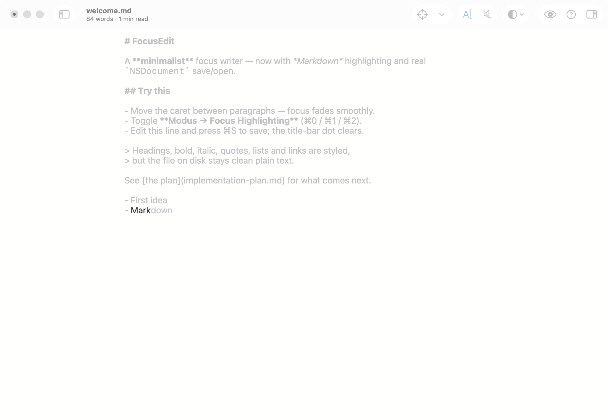
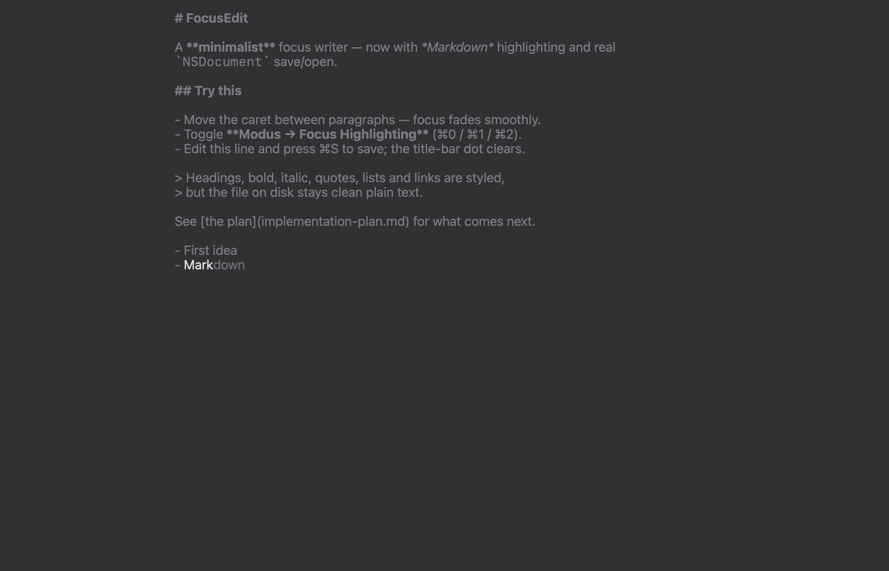

# FocusEdit

FocusEdit is a minimalist macOS text editor for distraction-free writing. It keeps your line in the middle of the screen, fades everything you are not working on, and saves plain text files: Markdown, Fountain screenplays or ordinary text.

**Version:** `0.3.1`, released 19.10.2026 · [changelog](CHANGELOG.md) · [how versions are managed](VERSION_MANAGEMENT.md)

<p align="center">
  
</p>

<table>
  <tr>
    <td width="50%"></td>
    <td width="50%">
      <b>Dark, Light and Sepia themes</b>, or your own.<br><br>
      Formatting stays visible in faded paragraphs: bold, italic and code keep their style while the color steps back.
    </td>
  </tr>
</table>

<sub>Screenshots come from <code>FocusEdit examples/welcome.md --snapshot</code>; see <a href="#command-line">Command line</a>.</sub>

> **Status: prototype.** Everything listed below works. Not yet done: iCloud sync and version conflicts, a Quick Look extension, screenplay page layout for Fountain PDF export, and a signed, notarized build.

## What it does

- **Focus** — highlight only the current sentence or paragraph, with a short fade as you move; keep the active line fixed at the centre of the window (typewriter scrolling); optional typewriter sounds; full screen hides the toolbar and the menu bar.
- **Writing aids** — a grey suggestion completes the word you are typing from words already in the document, then from the system dictionary (English and Russian); brackets and quotes close themselves and wrap a selection; Return continues Markdown lists, task lists and quotes. In Fountain, scene headings and character names you have used are suggested.
- **Plain text, styled on screen** — Markdown headings, emphasis, code, quotes, lists, links and CriticMarkup; Fountain scene headings, characters, parentheticals and transitions. Styling is display-only: the file on disk stays clean plain text.
- **Documents** — standard macOS documents: open, save, revert, recent files, drag and drop. A library sidebar browses a linked folder; the outline jumps between headings; the window subtitle shows the word count and reading time; find and replace.
- **Preview and export** — live HTML preview for Markdown, export as HTML or PDF, copy as HTML, print.
- **Themes and type** — Light, Dark, Sepia and custom themes; system, monospaced or serif font; three column widths.
- **Help where you are** — every toolbar button has a tooltip with its shortcut, and ⌘? opens a cheat sheet for the current document type.

## Shortcuts

| Keys | Action |
|---|---|
| Tab or → | Accept the grey suggestion |
| Esc · ⌥Esc | Dismiss the suggestion · list all completions |
| ⌘0 · ⌘1 · ⌘2 | Focus highlighting off · sentence · paragraph |
| ⌘T | Keep the active line centred |
| ⌘U | Typewriter sounds |
| ⇧⌘P | Live preview (Markdown) |
| ⌥⌘L · ⌥⌘O | Library · outline |
| ⌘B · ⌘I · ⌘K | Bold · italic · link |
| ⌃⌘F | Full screen |
| ⌘? | Hints and shortcuts |

## Requirements

- macOS 13 or later to run; Xcode 26 to build (tested with Xcode 26.5, Swift 6.3)
- No third-party dependencies: AppKit, WebKit and AVFoundation only
- Python 3 for `scripts/update_version.py` (standard library only)

## Build and run

```bash
./package.sh                                                   # build .build/FocusEdit.app
.build/FocusEdit.app/Contents/MacOS/FocusEdit examples/welcome.md
```

`package.sh` checks that the version files agree, runs `swift build`, assembles the app bundle, stamps a UTC build number, renders the app icon (it is drawn in code) and ad-hoc signs the bundle. Outside a sandboxed shell, `open .build/FocusEdit.app` works too. Always rebuild with `package.sh`: copying a new binary into an existing bundle invalidates its signature and macOS kills the app at launch.

To keep it, copy `.build/FocusEdit.app` into **Applications**. The build is ad-hoc signed, not notarized: it opens on the Mac that built it, while on another Mac macOS blocks it until you choose **System Settings → Privacy & Security → Open Anyway**.

The step-by-step build guide with common problems: [BUILD.md](BUILD.md) (in Russian).

## Command line

```bash
FocusEdit [file]                          # open a document
FocusEdit --selftest                      # headless checks: highlighting, completion, editing; exit 1 on failure
FocusEdit file --snapshot out.png         # render the window to PNG without screen-recording permission, then quit
          [--theme Dark] [--content]      #   pick a theme for the shot; keep only the area below the toolbar
FocusEdit --makeicon AppIcon.iconset      # render every icon size
```

The snapshot window stays invisible and never takes keyboard focus, and its demo typing is never saved.

## Project documents

- [BUILD.md](BUILD.md) — how to build, run and check (in Russian)
- [VERSION_MANAGEMENT.md](VERSION_MANAGEMENT.md) — how versions are changed and kept in sync (in Russian)
- [CHANGELOG.md](CHANGELOG.md) — what changed in each version
- [implementation-plan.md](../implementation-plan.md) — milestones M0–M6 (in Russian)

FocusEdit is an independent implementation written from scratch. Its feature set was modelled on uFocus, studied through static analysis of the shipped app bundle; no code, icons, sounds or other assets were copied, and the project is not affiliated with its authors.

## License

No license has been chosen yet.
